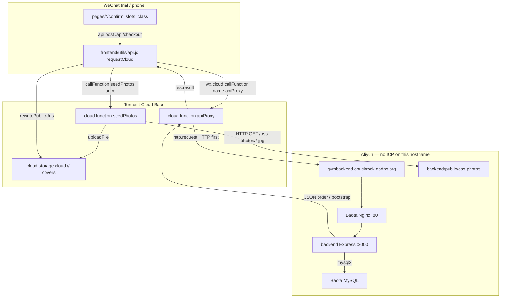
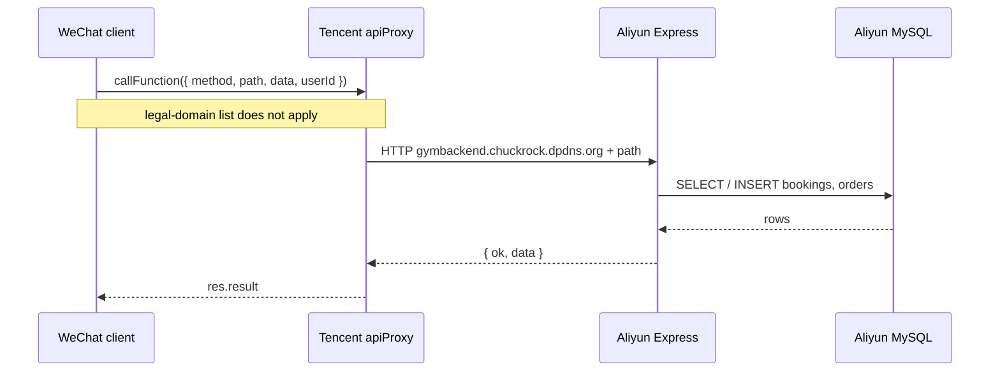
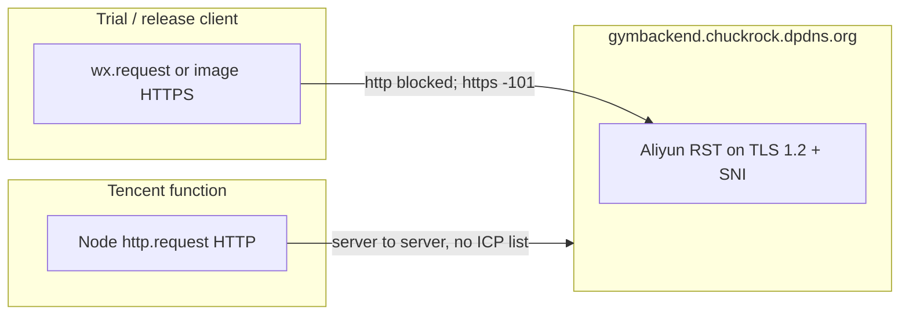
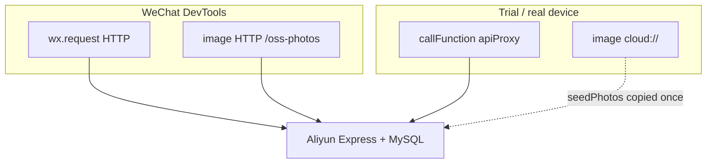

# Ranlian (燃练)

WeChat mini program that books gym classes **without an ICP-filed API domain**.

The client never talks to Aliyun. A **Tencent Cloud function** (`wx.cloud.callFunction`) HTTP-forwards to an **unfiled** host, and **Express on Aliyun** is the only process that touches **Baota MySQL**.

| | |
| --- | --- |
| AppID | `wx777a79a5b8dcaaac` |
| Cloud env | `cloud1-d9geo9d5d2420afe8` |
| Unfiled origin | `gymbackend.chuckrock.dpdns.org` |
| Express | `backend/` on Aliyun 轻量 — **still the real API** |
| MySQL | Baota on the same instance — **cloud functions do not run SQL** |

---

## A booking, end to end

Phone → Tencent `apiProxy` → unfiled Aliyun hostname → Nginx → Express → MySQL.





`wx.cloud.callFunction` sends `name` + `data` (WeChat Cloud docs). Express mounts `/api` and `listen`s (Express `app.use` / `app.listen`). The function is a Node `http.request` proxy — it does not `require` `backend/`.

| Hop | File |
| --- | --- |
| Wait for cloud, then bootstrap | `frontend/app.js` → `prepareCloud()` then `api.get('/api/bootstrap')` |
| Phone vs simulator split | `frontend/utils/api.js` → `request()` / `requestCloud()` |
| Env id | `frontend/utils/cloud-config.js` |
| HTTP forward, no SQL | `frontend/cloudfunctions/apiProxy/index.js` → `HOST` + `requestUpstream()` |
| Cover copies | `frontend/cloudfunctions/seedPhotos/index.js` |
| Rewrite `https://gymbackend.../oss-photos/` → `cloud://` | `frontend/utils/api.js` → `rewritePublicUrls()` |
| Express + static photos | `backend/src/index.js` → `/api`, `/oss-photos`, `/health` |
| Routes + mock pay | `backend/src/routes.js` |
| Pool | `backend/src/db.js` |

---

## Why the phone cannot hit Express itself



- Trial/release: HTTPS only, legal-domain check always on. `*.dpdns.org` cannot be ICP-filed, so it cannot be added as a request domain.
- WeChat Cronet uses TLS 1.2 + SNI. Aliyun resets that on this unfiled host (`-101` / `ERR_CONNECTION_RESET`). Browser TLS 1.3 succeeding does not prove WeChat can connect.
- Cloud-function outbound HTTPS to the same host also `ECONNRESET`. `apiProxy` therefore uses **HTTP first**.

Domain and Node are **not retired**. Only the *client* stopped calling them.

---

## Two runtimes



Open the `frontend` folder in DevTools, not the repo root.

```text
GymMiniprogram/
  frontend/                 DevTools project
    utils/api.js            split above
    cloudfunctions/         deploy separately; not packed into the mini program
  backend/                  Express on Baota
    public/oss-photos/      JPEG source of truth
```

---

## Run

1. Keep Baota Node (`gymbackend`) and MySQL up.
2. DevTools → `frontend` → skip legal-domain / TLS checks (**DevTools only**).
3. After function edits: right-click `apiProxy` / `seedPhotos` → upload and deploy.
4. Trial: toolbar Upload. First open runs `seedPhotos`.
5. Share works only for Experience members until a reviewed release.

Do not commit `backend/.env`.
